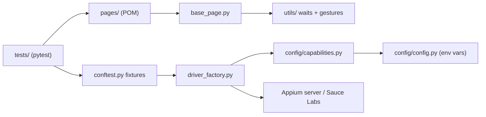

# Mobile QA Portfolio: Appium + pytest Framework for iOS & Android


An end-to-end mobile test automation framework for the [Sauce Labs My Demo App](https://github.com/saucelabs/my-demo-app-rn) (React Native), together with the manual QA deliverables a client would expect for a release: test plan, BDD scenarios, bug reports and CI.

> Built by **Goutham Kolla**, Mobile QA & Test Automation Engineer.
> [Freelancer](https://www.freelancer.com/u/gouthamk99) · [LinkedIn](https://www.linkedin.com/in/goutham-kolla/) · [GitHub](https://github.com/goutham909)

## What this demonstrates

| Area | Implementation |
| --- | --- |
| Design pattern | Page Object Model with fluent, chainable screen APIs |
| Locators | Accessibility IDs first; native text queries (UiAutomator / iOS predicate) as fallback; no absolute XPath |
| Synchronisation | Explicit waits only. No `time.sleep()`, implicit wait set to 0 |
| Gestures | W3C Actions (swipe, long-press, pull-to-refresh, scroll-to-element) using screen-relative coordinates |
| Cross-platform | One suite for Android (UiAutomator2) and iOS (XCUITest), selected with `PLATFORM` |
| Execution targets | Local emulator/simulator, real devices, Sauce Labs cloud (`RUN_ON`) |
| Evidence | A screenshot and UI hierarchy XML are captured on every failure and embedded in the HTML report |
| CI | GitHub Actions: lint, Android emulator smoke on every push, nightly regression, on-demand Sauce Labs |
| Manual QA | Test plan, device matrix, traceability, BDD interrupt and network scenarios, sample bug reports |

## Architecture



```text
mobile-qa-portfolio/
├── .github/workflows/mobile_tests.yml   CI pipeline
├── config/
│   ├── capabilities.py                  UiAutomator2 / XCUITest / Sauce Labs options
│   └── config.py                        Environment-driven settings and test users
├── pages/
│   ├── base_page.py                     Shared element access, platform-aware locators
│   ├── login_page.py
│   ├── inventory_page.py                Catalog, product details, cart badge
│   └── checkout_page.py                 Cart, shipping, payment, review, confirmation
├── tests/
│   ├── conftest.py                      Driver fixture, login fixtures, failure evidence
│   ├── test_login.py
│   └── test_checkout.py
├── utils/
│   ├── driver_factory.py
│   ├── gesture_helpers.py
│   └── wait_helpers.py
├── test_artifacts/
│   ├── bdd_features/
│   │   ├── interrupt_testing.feature
│   │   └── network_throttling.feature
│   ├── test_plan.md
│   └── sample_bug_reports.md
├── website/                             Portfolio site (deployed on Vercel)
├── requirements.txt
├── pytest.ini
└── vercel.json
```

## Test coverage

| Test | Marker | What it proves |
| --- | --- | --- |
| `test_valid_login_lands_on_catalog` | smoke | A standard user reaches a populated catalog |
| `test_invalid_login_is_rejected` (5 cases) | regression | Locked-out user, empty fields, wrong password and unknown user each show the right error and stay on the login screen |
| `test_end_to_end_purchase` | smoke | Product, cart, shipping, payment, review and confirmation |
| `test_cart_badge_tracks_quantity` | regression | The cart badge reflects the quantity added |
| `test_shipping_requires_mandatory_fields` | regression | An empty shipping form is blocked and every required-field message is shown |

## Getting started

### Prerequisites
- Python 3.10+
- Node.js 18+ and Appium 2:
  ```bash
  npm install -g appium
  appium driver install uiautomator2   # Android
  appium driver install xcuitest       # iOS (macOS only)
  ```
- Android Studio with an emulator, or Xcode with an iOS simulator
- The app under test, from the [My Demo App v1.3.0 release](https://github.com/saucelabs/my-demo-app-rn/releases/tag/v1.3.0):
  ```bash
  mkdir -p apps
  # Android
  curl -L -o apps/my-demo-app.apk \
    https://github.com/saucelabs/my-demo-app-rn/releases/download/v1.3.0/Android-MyDemoAppRN.1.3.0.build-244.apk
  # iOS simulator
  curl -L -o apps/ios-sim.zip \
    https://github.com/saucelabs/my-demo-app-rn/releases/download/v1.3.0/iOS-Simulator-MyRNDemoApp.1.3.0-162.zip
  unzip -q apps/ios-sim.zip -d apps/
  ```

### Install
```bash
python -m venv .venv && source .venv/bin/activate
pip install -r requirements.txt
cp .env.example .env   # optional; every setting has a default
```

### Run
```bash
appium                                   # terminal 1

pytest -m smoke                          # Android emulator (default)
pytest -m "smoke or regression"          # full suite
PLATFORM=ios DEVICE_NAME="iPhone 15" APP_PATH=apps/MyRNDemoApp.app pytest
pytest -n 2 --reruns 1                   # parallel, retrying infrastructure flakes once
```

The HTML report is written to `reports/report.html`. Failure screenshots and UI hierarchy dumps go to `reports/failures/`.

### Run on Sauce Labs
1. Upload the APK/IPA to Sauce Labs App Storage.
2. Run:
   ```bash
   RUN_ON=saucelabs SAUCE_USERNAME=... SAUCE_ACCESS_KEY=... \
   APP_PATH="storage:filename=Android-MyDemoAppRN.1.3.0.build-244.apk" \
   DEVICE_NAME="Google Pixel.*" pytest -m smoke
   ```

In CI, add `SAUCE_USERNAME` and `SAUCE_ACCESS_KEY` as repository secrets and `SAUCE_ANDROID_APP` / `SAUCE_IOS_APP` as repository variables. Then start the workflow from **Actions > Mobile Tests > Run workflow** with target `saucelabs`.

## Configuration

| Variable | Default | Purpose |
| --- | --- | --- |
| `PLATFORM` | `android` | `android` or `ios` |
| `RUN_ON` | `local` | `local` or `saucelabs` |
| `APPIUM_URL` | `http://127.0.0.1:4723` | Local Appium server |
| `DEVICE_NAME` | `Android Emulator` / `iPhone 15` | Target device |
| `PLATFORM_VERSION`, `UDID` | empty | Pin an OS version or a specific device |
| `APP_PATH` | `apps/my-demo-app.apk` | Build to install. If the file is missing, the already-installed app is launched |
| `EXPLICIT_WAIT` | `15` | Default wait timeout in seconds |

## Locator strategy

1. **Accessibility ID** (`content-desc` on Android, `accessibilityIdentifier` on iOS). This is stable across platforms and also improves real accessibility.
2. **Native text query** (`UiSelector().textContains` / `label CONTAINS`) for validation messages and product names. It is evaluated by the platform engine, so it is much faster and less fragile than XPath.
3. Everything is defined once in a page object, so a UI change means a one-line fix.

> **Note:** locators follow the documented accessibility IDs of My Demo App v1.3.0. They have not yet been checked against a live device session in this repository. Check them with Appium Inspector before the first run and adjust the constants in `pages/` if a build differs.

## Manual QA artifacts

- [Test plan](test_artifacts/test_plan.md): scope, approach, device matrix, entry and exit criteria, risks, traceability
- [Sample bug reports](test_artifacts/sample_bug_reports.md): severity and priority, environment, reproduction steps, evidence
- [Interrupt testing](test_artifacts/bdd_features/interrupt_testing.feature): calls, SMS, backgrounding, process death, rotation, lock screen
- [Network throttling](test_artifacts/bdd_features/network_throttling.feature): offline, 2G/3G, network handover, latency, timeouts

## Portfolio website

`website/` is a static site (HTML, CSS and a small amount of JS) with no build step. All of its content comes from [`website/profile.json`](website/profile.json); edit that file to update your details.

**Preview locally**
```bash
cd website && python3 -m http.server 8000   # open http://localhost:8000
```

**Live site:** [https://goutham-kolla-portfolio.vercel.app/](https://goutham-kolla-portfolio.vercel.app/)

Every push to `main` redeploys automatically on Vercel. Artifact links and the CI badge point at `https://github.com/goutham909/mobile-qa-portfolio`.

## Author

**Goutham Kolla**, Mobile QA & Test Automation Engineer, Hyderabad, India
Manual, exploratory and automated testing for Android, iOS, Flutter and React Native.

- Portfolio: <https://goutham-kolla-portfolio.vercel.app/>
- Freelancer: <https://www.freelancer.com/u/gouthamk99>
- LinkedIn: <https://www.linkedin.com/in/goutham-kolla/>
- GitHub: <https://github.com/goutham909>
- Repository: <https://github.com/goutham909/mobile-qa-portfolio>
